<style>
section { font-family: Arial, sans-serif; font-size: 24px; line-height:1.3; padding:48px 58px 50px; justify-content:center; color:#243344; background-color:#fff; }
h1 { font-size:48px; color:#165b48; }
h2 { font-size:34px; line-height:1.15; color:#28734f; margin:0 0 22px; }
h3 { font-size:26px; margin:10px 0; }
p, ul, ol { margin:10px 0; }
li { margin:5px 0; }
table { font-size:23px; width:100%; }
th { background:#e5f2ec; }
td,th { padding:8px 12px; }
section img { max-height:420px; max-width:100%; object-fit:contain; }
section > p:has(img) { text-align:center; margin:8px 0; }
section:has(> div.image) { display:grid; grid-template-columns:58% 38%; gap:12px 28px; align-content:center; }
section:has(> div.image) > h2 { grid-column:1 / -1; }
section:has(> div.image) > .content { grid-column:1; }
section:has(> div.image) > .image { grid-column:2; text-align:center; }
.image img { max-height:330px; width:100%; }
.image:has(img + img) img { max-height:190px; }
section.titleslide { text-align:center; }
section.titleslide h1 { font-size:48px; }
section.titleslide h2 { color:#255b89; }
.source { font-size:15px; line-height:1.25; color:#54656a; margin-top:18px; overflow-wrap:anywhere; }
.source a { color:#327061; }
.big { font-size:56px; color:#217a62; font-weight:bold; margin:10px 0; }
.def,.trend { background:#edf5f0; border-left:4px solid #45866a; padding:8px 12px; margin:8px 0; }
.chip { display:inline-block; font-size:18px; background:#edf5f0; padding:5px 8px; margin:3px; }
footer { font-size:14px; }
</style>


<!-- _class: titleslide -->
<!-- _paginate: false -->

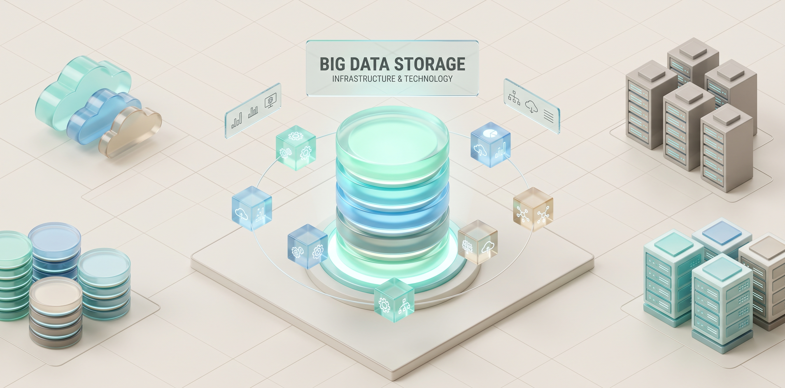

# Технологии хранения данных (ч. 1).

## Лекция №2

---
## План лекции

1. Подходы хранения данных.
2. Модели данных.


---
  

## 1. Подходы хранения данных

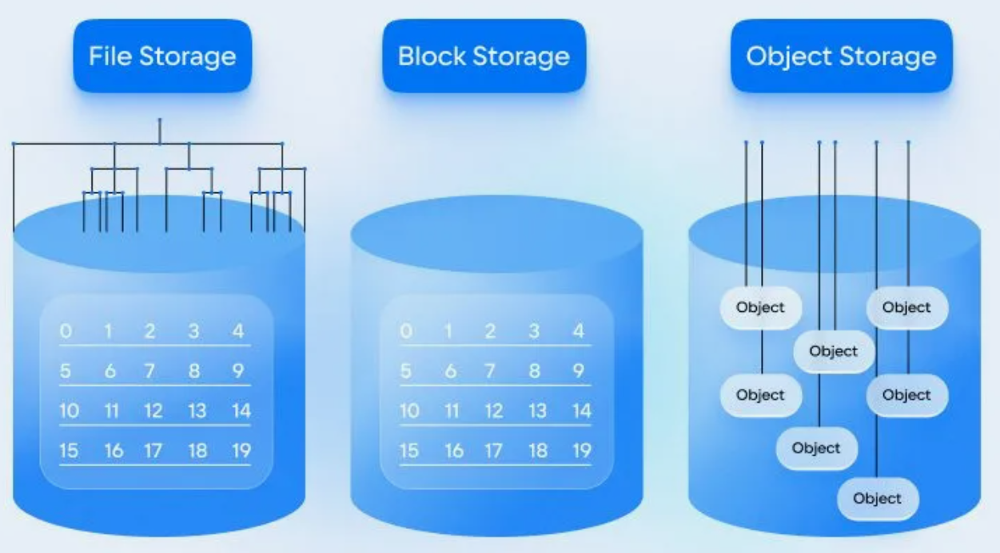

---

  


## 📋 Что такое файловый подход?

- 🖥️ Каждое приложение работает со **своими собственными файлами**
- 📄 Данные хранятся в **плоских файлах** (flat files)
- 📏 Формат данных: **записи с полями фиксированной длины**

```text

Иванов Иван Иванович______Менеджер______________00001
Петров Петр Петрович______Разработчик___________00002

```

> *где _ — пробелы для заполнения*

---


## 📚 Аналогия: Библиотека без системы

<div class = content>

- 📓 Каждая тетрадь = отдельный файл
- 🔍 Нет общего каталога
- 📝 Данные дублируются в разных тетрадях
- ⏱️ Чтобы найти информацию — нужно перебрать все тетради

</div>

---

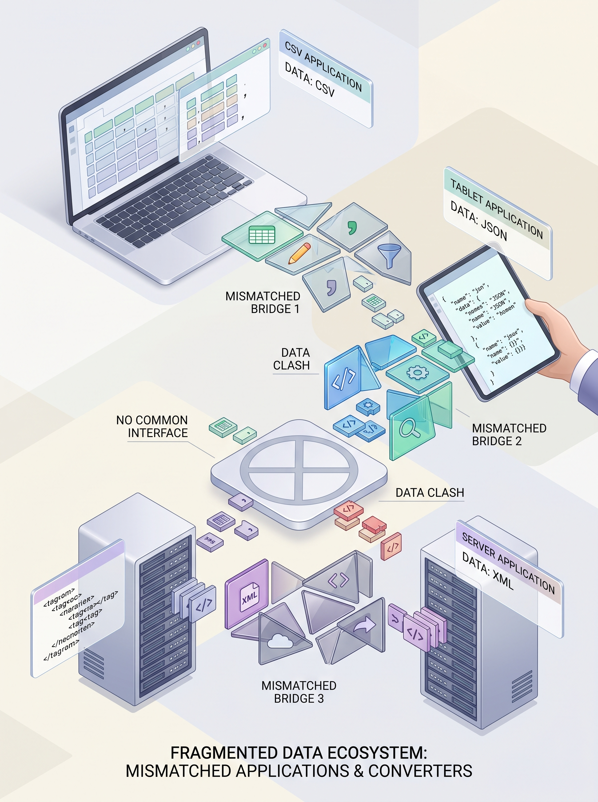

## 🚨 Проблема 1: Совместная обработка данных


- 🔗 Трудно организовать обработку данных из разных файлов
- 📊 Каждое приложение имеет свой формат данных
- 🌉 Для совместной обработки нужны программы-«мосты»
- 🚫 Нет стандартного интерфейса доступа к данным

> Пример: 📊 Бухгалтерия и 👥 отдел кадров работают с разными файлами сотрудников

---

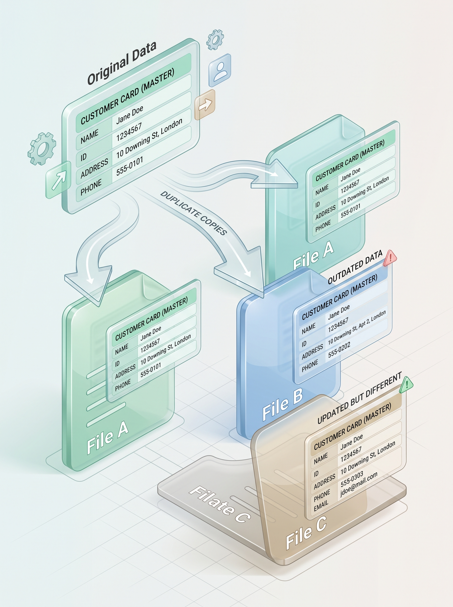

## 🚨 Проблема 2: Дублирование данных

**Одни и те же данные хранятся в нескольких местах**

- 📫 Клиентские адреса в файле заказов и в файле рассылки
- 👨‍💼 Информация о сотрудниках в разных отделах
- 💸 Следствия: избыточность, риск несогласованности

---

## Проблема 3: Зависимость приложений от данных

**🔗 Логика приложения жестко привязана к структуре файла**

- 🔄 Любое изменение структуры файла требует переписывания ВСЕХ программ

```python
# Программа ожидает строго определенный формат
fio = file.read(30)    # ФИО всегда 30 символов
position = file.read(20) # Должность 20 символов
```

---

## 🚨 Проблема 4-5: Безопасность и целостность

**🔓 Нет контроля доступа**
- 🚪 Доступ по принципу «все или ничего»
- 👥 Невозможно настроить права для разных пользователей

**⚠️ Нет гарантий целостности**
- 📝 Можно записать любые данные (отрицательная зарплата)
- ✅ Нет проверок на корректность
- 🏢 Нет механизмов соблюдения бизнес-правил

---

## 🚨 Проблема 6: Восстановление после сбоев

- **⚡ Процесс обновления файла**
  1. 📖 Считать данные
  2. ✏️ Изменить в памяти
  3. 💾 Записать обратно
- 💥 **При сбое на шаге 3: данные теряются или повреждаются**
- ↩️ **Нет механизма отката к предыдущему согласованному состоянию**

---

## 🚨 Проблема 7: Совместный доступ

**⚔️ Конфликты при параллельной работе**

- 🔒 Файл блокируется целиком на время записи
- ⏳ Пока один пользователь редактирует, другие ждут
- 🚫 Нет изоляции транзакций
- 📉 Высокий риск потери данных

---


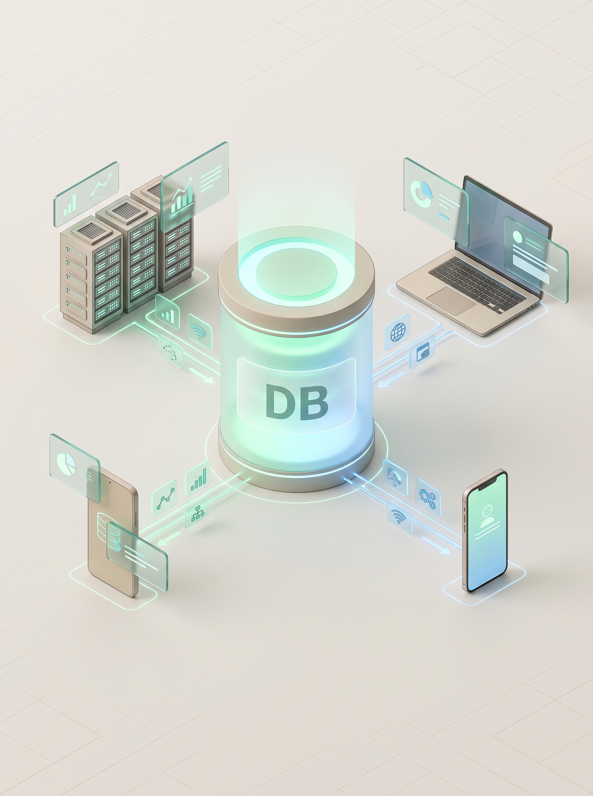

## 📊 Подход на основе баз данных

- **🗂️ Данные:** хранение в базе данных
- **🏗️ Формат/структура данных:** определяется логикой модели данных
- **🔗 Логическая связанность** данных вместо разрозненных файлов

---


## 📚 Определение базы данных


<div class="def">

**База данных** — коллекция логически связанных данных и их описаний, предназначенная для удовлетворения информационных потребностей предприятия.

</div>

<div class="def">

**База данных** — набор перманентных (постоянно хранимых) данных, используемых прикладными программными системами какого-либо предприятия.

</div>

**🎯 Ключевые аспекты:**

<span class="chip">✅ Постоянное хранение</span>
<span class="chip">✅ Корпоративное использование</span>
<span class="chip">✅ Интеграция с приложениями</span>

---

## 📊 Основные характеристики

**Данные: хранение в базе данных**
**Формат/структура данных: определяется логикой модели данных**

**🎯 Ключевые особенности:**
- ✅ Централизованное хранение данных
- ✅ Логическая структура вместо физических файлов
- ✅ Единая модель данных для всех приложений
- ✅ Профессиональное управление информацией

---


## 💾 Постоянное хранение данных

<div class="def">

**База данных — это некоторый набор перманентных (постоянно хранимых) данных, используемых прикладными программными системами какого-либо предприятия.**

</div>

**🎯 Важные аспекты:**

<span class="chip">💫 Перманентность</span>
<span class="chip">🖥️ Прикладные системы</span>
<span class="chip">🏢 Корпоративный масштаб</span>
<span class="chip">🔄 Непрерывная доступность</span>

---


## 📖 Метаданные - словарь данных

<div class="def">

**Описания данных – системный каталог, или словарь данных, или метаданные (данные о данных).**

</div>

**📋 Что включают метаданные:**

<span class="chip">🏷️ Структуры таблиц и полей</span>
<span class="chip">📏 Типы и ограничения</span>
<span class="chip">🔑 Ключи и индексы</span>
<span class="chip">👥 Права доступа</span>
<span class="chip">📊 Статистика использования</span>

---

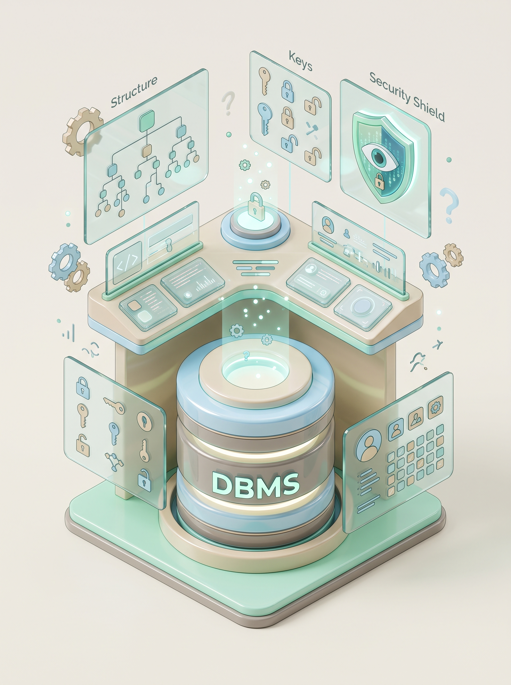

## ⚙️ СУБД - управляющая система


<div class="def">

**Система управления базами данных (СУБД)** – программная система, позволяющая пользователям определять, создавать, поддерживать данные и управлять доступом к базе данных. 

</div>

**🛠️ Основные функции СУБД:**

<span class="chip">📝 Определение структуры</span>
<span class="chip">🏗️ Создание и модификация</span>
<span class="chip">🔧 Поддержка и обслуживание</span>
<span class="chip">🛡️ Доступ и безопасность</span>

---


## 💻 Комплексная система хранения

<div class="def">

**Система баз данных** — это компьютеризированная система хранения записей, основное назначение которой — хранить информацию, предоставляя пользователям средства ее извлечения и модификации.

</div>

**🏗️ Компоненты системы:**

<span class="chip">💾 Аппаратное обеспечение</span>
<span class="chip">🗄️ База данных</span>
<span class="chip">⚙️ СУБД</span>
<span class="chip">👥 Пользователи и админы</span>
<span class="chip">📊 Прикладные программы</span>

---


## 🎯 Преимущества подхода БД

<div class="def">

**✅ Централизованное управление**
- Единая точка контроля
- Согласованность данных
- Оптимизация производительности

</div>

<div class="def">

**✅ Снижение избыточности**

- Исключение дублирования
- Эффективное использование ресурсов
- Снижение затрат на хранение

</div>

---


## 🛡️ Обеспечение целостности и безопасности

<div class="def">

**✅ Гарантии целостности данных**
- Ограничения и правила валидации
- Транзакции ACID
- Восстановление после сбоев

</div>

<div class="def">

**✅ Многоуровневая безопасность**

- Аутентификация пользователей
- Авторизация и права доступа
- Аудит операций с данными

</div>

---


## 🔄 Совместное использование данных

<div class="def">

**✅ Многопользовательский доступ**
- Параллельная работа без конфликтов
- Управление блокировками
- Изоляция транзакций

</div>

<div class="def">

**✅ Независимость от приложений**

- Изменение структуры без переписывания кода
- Единый интерфейс доступа
- Стандартизированные протоколы

</div>

---

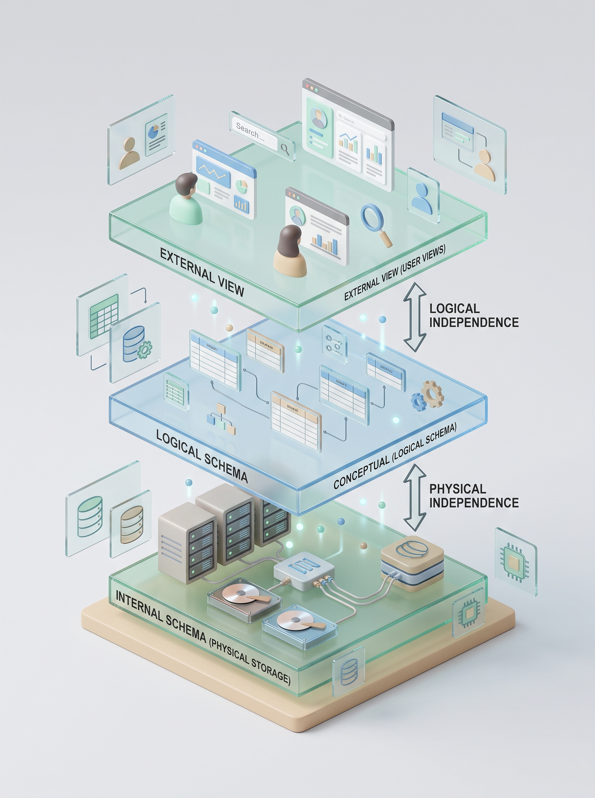

## 🌟 Уровни архитектуры БД


<div class = content>

**🏗️ Трехуровневая архитектура ANSI/SPARC:**
1. **Внешний уровень** - представления для пользователей
2. **Концептуальный уровень** - логическая структура данных  
3. **Внутренний уровень** - физическое хранение на дисках

**🎯 Принцип независимости:**
- Физическая независимость
- Логическая независимость

</div>

<div class = image>

</div>

---


## 💡 Ключевые выводы

<div class="def">

**🎯 Подход на основе БД обеспечивает:**
- Профессиональное управление корпоративными данными
- Гарантии целостности и безопасности информации
- Эффективное многопользовательское взаимодействие
- Масштабируемость для растущих потребностей

</div>

<div class="def">

**🚀 СУБД превращает данные в стратегический актив предприятия!**

</div>

---


## ⚖️ Сравнение подходов: Файлы vs Базы данных

| Критерий | 📁 Файловый подход | 🗄️ Базы данных |
|----------|-------------------|----------------|
| **Структура данных** | Разрозненные файлы | Единая логическая модель |
| **Связи между данными** | Отсутствуют | Логические связи через ключи |
| **Многопользовательский доступ** | Конфликты, блокировки файлов | Управление параллельным доступом |
| **Безопасность** | Права на уровне файлов | Гранулярные права доступа |
| **Метаданные** | В каждом приложении отдельно | Централизованный словарь данных |

---


## ⚖️ Сравнение подходов: Файлы vs Базы данных

| Критерий | 📁 Файловый подход | 🗄️ Базы данных |
|----------|-------------------|----------------|
| **Целостность данных** | Нет гарантий | Ограничения, транзакции ACID |
| **Восстановление после сбоев** | Сложно, риск потери | Журналирование, откат транзакций |
| **Производительность** | Линейный поиск | Индексы, оптимизация запросов |
| **Изменение структуры** | Переписывание приложений | Независимость данных |
| **Масштабируемость** | Ограничена | Горизонтальное и вертикальное |

---


## ⚠️ Недостатки баз данных


<div class="def">

**🎯 Обзор проблемных аспектов:**
- 🏗️ Сложность реализации и сопровождения
- 💰 Высокие финансовые затраты
- ⚡ Производительность и надежность
- 👥 Требования к квалификации персонала

</div>

<div class="def">

**Базы данных — это не панацея, а сложный инструмент со своими ограничениями**

</div>

---

## 🏗️ Сложность организации

**Сложность (нужны специалисты)**

**👥 Многоуровневая структура пользователей:**
- 👨‍💻 Прикладные программисты
- 👩‍💼 Конечные пользователи
- 🛠️ Администраторы баз данных (АБД / DBA)
- 🏗️ Администраторы/архитекторы данных (АД / DA)
- 📐 Проектировщики базы данных

**Каждая роль требует специальных знаний и навыков**

---


## 👥 Ключевые роли в управлении БД


<div class="def">

**🛠️ Администратор базы данных (DBA):**
- Установка и настройка СУБД
- Резервное копирование и восстановление
- Мониторинг производительности
- Управление безопасностью

</div>

<div class="def">

**🏗️ Администратор/архитектор данных (DA):**

- Проектирование логической структуры
- Разработка стандартов данных
- Планирование развития системы
- Управление метаданными

</div>

---

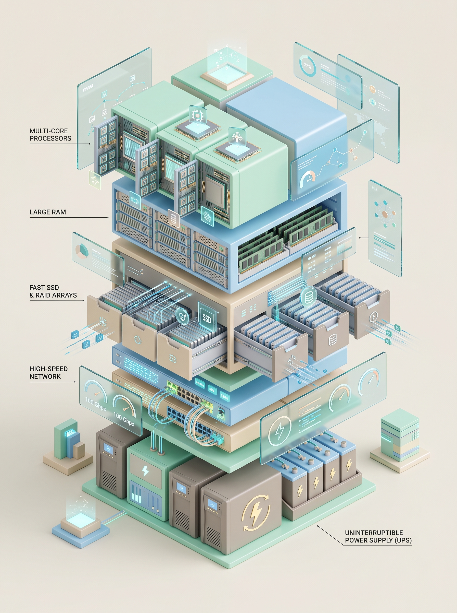

## 💾 Аппаратные требования

**Большой масштаб (следствие – требуется мощное аппаратное обеспечение, много памяти, быстрые процессоры)**

**⚡ Высокие требования к инфраструктуре:**
- 🖥️ Мощные серверы с многоядерными процессорами
- 💽 Быстрые системы хранения (SSD, RAID)
- 📊 Большой объем оперативной памяти
- 🔄 Высокоскоростная сетевая инфраструктура
- ⚡ Системы бесперебойного питания

---

## 💰 Финансовые затраты

**Высокая стоимость коммерческих СУБД, но есть альтернатива – свободное ПО, например, PostgreSQL, но с позиции стоимости это не точно… :-)**

**📊 Структура затрат:**
- 💸 Лицензии на коммерческие СУБД (Oracle, SQL Server)
- 🖥️ Дорогое аппаратное обеспечение
- 👥 Зарплаты квалифицированных специалистов
- 📚 Обучение и сертификация персонала
- 🔧 Техническая поддержка и обновления

---

## 🔄 Стоимость миграции

**Высокая стоимость перехода от устаревших систем, основанных на файлах, к современным СУБД**

**🔄 Затраты на миграцию включают:**
- 📊 Анализ и проектирование новой структуры
- 🔄 Конвертацию данных из старых форматов
- 🧪 Тестирование и отладку системы
- 👥 Обучение пользователей новым интерфейсам
- ⏱️ Простой бизнес-процессов во время перехода

---

## ⚡ Производительность

**Более низкая скорость работы, чем у специализированных приложений, написанных с учетом специфики решаемой задачи**

**📉 Факторы снижения производительности:**
- 🎯 Универсальность vs специализация
- 🔄 Накладные расходы СУБД
- 📊 Оптимизация для общего случая
- ⚡ Задержки на управление транзакциями
- 🔒 Блокировки и управление параллельным доступом

---


## 🚨 Риски отказов


<div class="def">

**Большой масштаб проблем при сбоях сервера баз данных**

</div>

**💥 Масштаб последствий сбоя:**

<span class="chip">🚫 Все приложения недоступны</span>
<span class="chip">💼 Остановка процессов</span>
<span class="chip">📉 Потеря транзакций</span>
<span class="chip">🔄 Долгое восстановление</span>
<span class="chip">🏢 Репутационные потери</span>

---

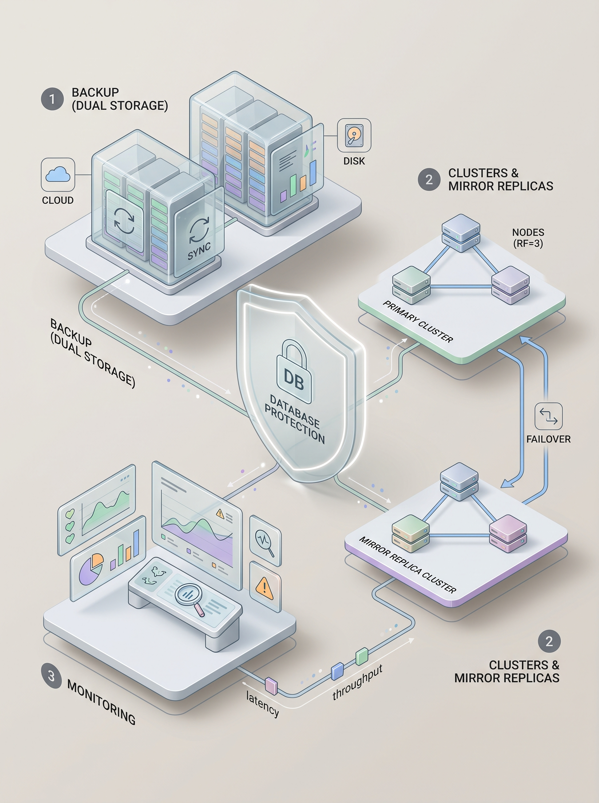

## 🛡️ Меры снижения рисков


<div class="def">

**✅ Стратегии минимизации недостатков:**
- 🔄 Регулярное резервное копирование
- ⚡ Кластеризация и репликация
- 📊 Мониторинг производительности
- 👥 Обучение и сертификация персонала
- 🧪 Тщательное тестирование изменений

</div>

<div class="def">

**Правильная архитектура и грамотное администрирование позволяют минимизировать риски**

</div>

---


## ⚖️ Баланс преимуществ и недостатков

**✅ Преимущества БД:**
- Централизованное управление данными
- Гарантии целостности и безопасности
- Эффективное многопользовательское использование
- Стандартизированные интерфейсы доступа

**❌ Недостатки БД:**
- Высокая сложность и стоимость
- Требования к квалификации персонала
- Риски централизованного отказа
- Накладные расходы на производительность

---


## 💡 Выводы

<div class="def">

**🎯 Критически важные аспекты:**
- Базы данных требуют серьезных инвестиций
- Необходима команда квалифицированных специалистов
- Важна продуманная архитектура и инфраструктура
- Требуются планы аварийного восстановления

</div>

<div class="def">

**Решение о внедрении БД должно быть экономически обоснованным и учитывать все затраты**

</div>

---

  

## 2. Модели данных

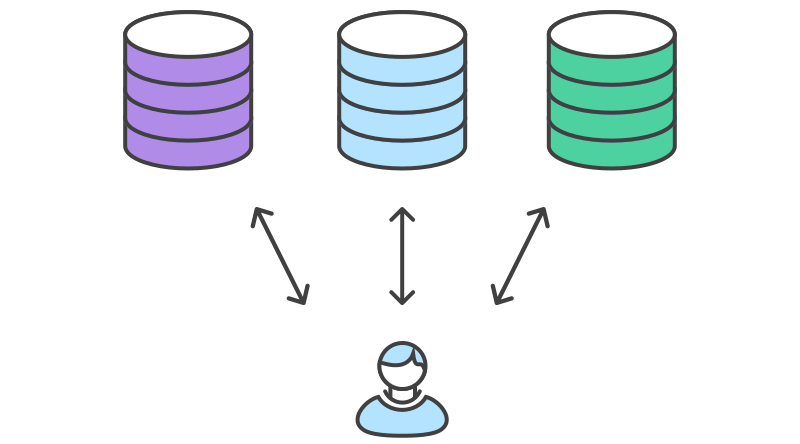

---

## Что такое модель данных?

*   **Формальная система** для описания, представления и работы с данными.
*   **Определяет:**
    *   Структуру данных (как данные организованы).
    *   Ограничения (какие данные допустимы).
    *   Операции (как данные можно изменять и запрашивать).
*   **Выбор модели определяет** эффективность решения задач.

---

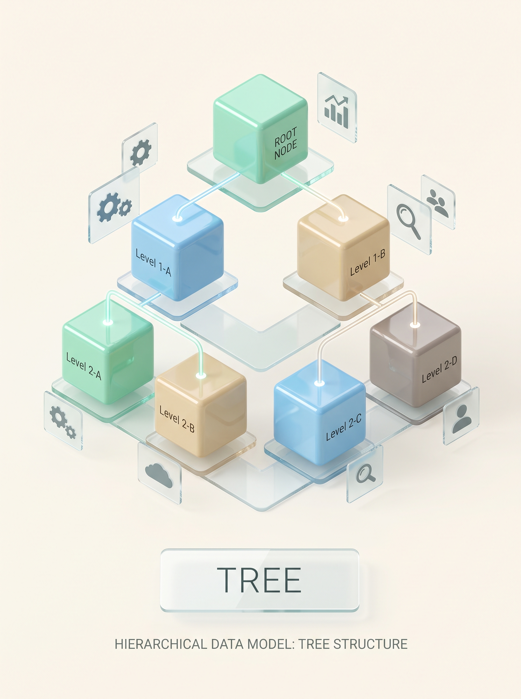

## 1. Иерархическая модель


<div class = content>

**Суть:** Данные организованы в виде дерева (древовидная структура) с отношениями «предок-потомок».
- **Структура**: Узел может иметь только одного родителя.
- **Операции**: Навигация от корня вниз.
- **Плюсы**: Высокая скорость доступа к данным, следующих по иерархии.
- **Минусы**: Сложность изменения структуры, избыточность данных, неестественность для сложных связей.

> Пример: Файловые системы, реестр Windows, IBM IMS.

</div>


---

## 2. Сетевая модель


<div class = content>

**Суть:** Развитие иерархической модели. Узел может иметь несколько родителей, образуя сеть.
- **Структура**: Сложные связи "многие-ко-многим" реализуются напрямую.
- **Операции**: Более гибкая навигация, но сложная.
- **Плюсы**: Более гибкая, чем иерархическая, меньше избыточности.
- **Минусы**: Высокая сложность проектирования и приложений, неестественность для сложных связей.

> Пример: CODASYL, IDMS.

</div>

<div class = image>

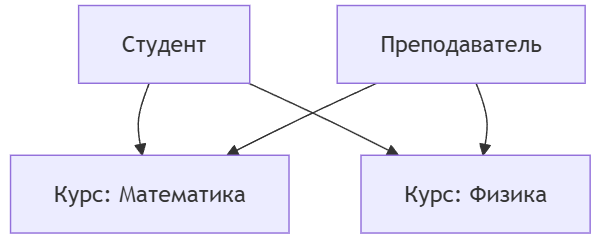

</div>

---

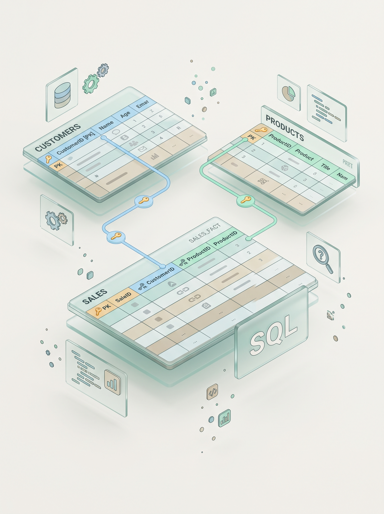

## 3. Реляционная модель


<div class = content>

**Суть:** Данные представлены в виде набора взаимосвязанных таблиц (отношений).
- **Структура**: 
  - Таблица (Отношение): Студенты (id, Имя, Группа)
  - Строка (Кортеж): (101, 'Иван Иванов', 'БД-01')
  - Столбец (Атрибут): Имя
  - Связи: через ключи (первичные и внешние)
- **Операции**: SQL (Structured Query Language) — декларативный язык запросов.
- **Плюсы**: ростота понимания, мощный математический фундамент, независимость данных, ACID-транзакции.
- **Минусы**: Сложность горизонтального масштабирования для очень больших объемов.

> Пример: PostgreSQL, MySQL, Oracle Database.

</div>

<div class = image>

</div>

---

## 4. Объектно-ориентированная модель


<div class = content>

**Суть:** Данные хранятся в виде объектов, как в объектно-ориентированном программировании (ООП).
- **Структура**: Объекты с атрибутами, методами и наследованием. 
- **Операции**: Работа через методы объектов.
- **Плюсы**: Прямое отображение объектов программы на БД, нет "импеданса" (несоответствия).
- **Минусы**: Сложность, низкая популярность, вытеснена более простыми решениями.

> Пример: Objectivity/DB, Versant. *Идея живет в ORM (Hibernate) для реляционных БД.*

</div>

<div class = image>

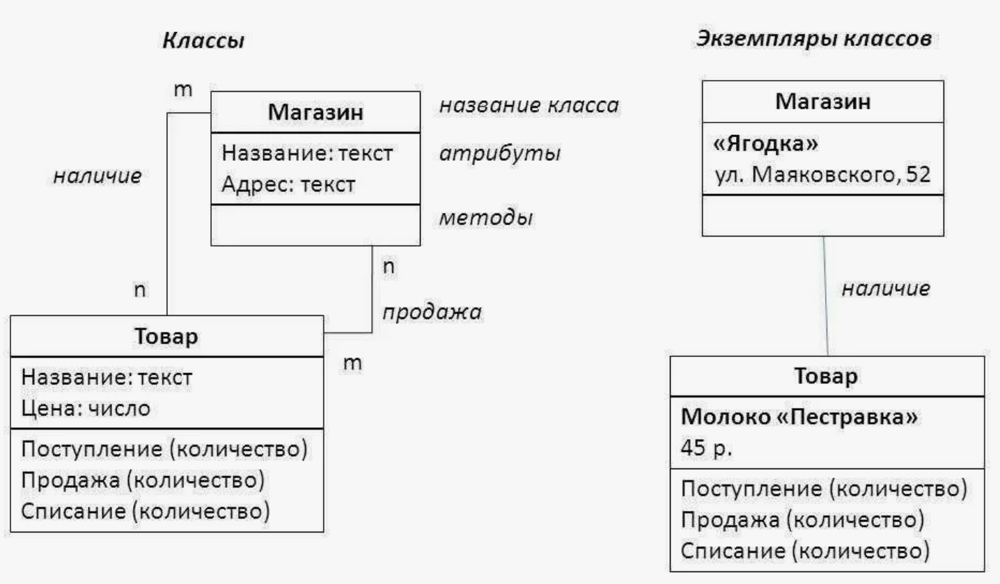

</div>

---


## 5. Документная (Документ-ориентированная) модель


<div class = content>

**Суть:** Подвид NoSQL. Данные хранятся в виде документов (например, JSON/BSON).
- **Структура**: Коллекции документов. Документы самодостаточны и могут иметь разную структуру. 
- **Операции**: Запросы по полям документа. CRUD-операции.
- **Плюсы**: Гибкая схема, естественность для разработки (JSON), высокая производительность для определенных сценариев.
- **Минусы**: Связи между коллекциями требуют проектирования; MongoDB поддерживает $lookup, дублирование данных.

> **Примеры**: MongoDB, Couchbase.

</div>

---

## 6. Хранилища «ключ-значение» (Key-Value)


<div class = content>

**Суть:** Простейшая модель NoSQL. Данные — ассоциативный массив (словарь).
- **Структура**: Уникальный ключ → значение (часто неструктурированное для СУБД). 
- **Операции**: PUT(key, value), GET(key), DELETE(key).
- **Плюсы**: Максимальная скорость и масштабируемость для простых операций.
- **Минусы**: Возможности запросов зависят от СУБД.

> **Примеры**: Redis, Amazon DynamoDB, etcd.

</div>

<div class = image>

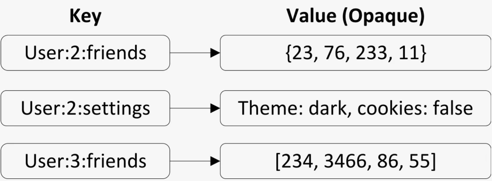

</div>

---

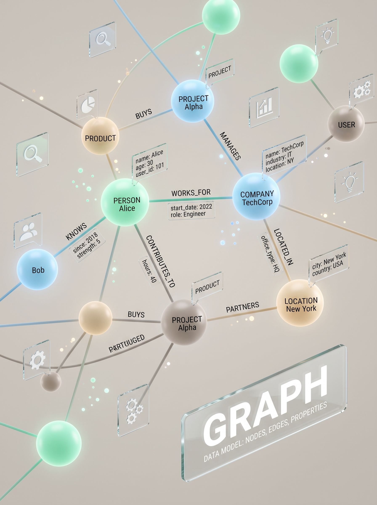

## 7. Графовая модель


<div class = content>

**Суть:** Данные представлены в виде узлов, свойств и ребер (связей).
- **Структура**: 
  - Узлы (Node/Vertex): Сущности (например, Студент, Группа).
  - Ребра (Edge/Relationship): Связи между узлами (ДРУЖИТ_С, УЧИТСЯ_В). Могут иметь свои свойства.
- **Операции**: Запросы на обход графа (найти друзей друзей).
- **Плюсы**: Невероятно эффективна для анализа связей.
- **Минусы**: Неэффективна для агрегаций и задач, не связанных с обходом связей.

> **Примеры**: Neo4j, Amazon Neptune.

</div>

<div class = image>

</div>

---


## 8. Хранение по столбцам

**ClickHouse:** столбцы таблицы хранятся отдельно; удобно читать нужные поля для агрегатов.

**Cassandra / HBase:** семейства столбцов (wide-column); другая модель организации данных.

Эти подходы нельзя отождествлять.

<div class="source"><a href="https://clickhouse.com/docs/intro">ClickHouse: вводное руководство</a> · <a href="https://cassandra.apache.org/doc/latest/cassandra/developing/data-modeling/intro.html">Cassandra: модель данных</a></div>

---

<!-- fact-check: подтверждено; источник: https://www.yandex.ru/company/news/2016-0615 -->

## Фактчек: откуда появился ClickHouse

**Подтверждено:** разработан в Яндексе для Метрики; исходный код опубликован **15 июня 2016 года**.

Это дата открытия кода, а не начала разработки.

<div class="source"><a href="https://www.yandex.ru/company/news/2016-0615">Официальная новость Яндекса</a></div>

---

<!-- prompt: Isometric 3D illustration, soft pastel palette (mint green, sky blue, sandy), exactly one small transparent table separating into three simple vertical column stacks, one subtle glass magnifying lens inspecting only one column, glossy translucent elements, clean tech style, soft studio lighting, pure light background, no text, no letters, no logos, no extra floating dashboards or repeated mini-diagrams. Single compact central scene, generous blank margins, readable at small size in the right 35 percent of an educational slide. Portrait. -ar 3:4 -->


## 8. 🗄 Колоночная — кейс Яндекс

<div class="big">2,5 ПБ</div>

- Задача: аналитика больших массивов.
- Решение: управляемый кластер ClickHouse.
- Результат: такой объём достигнут у внешнего заказчика Yandex Cloud.

<div class="source"><a href="https://yandex.cloud/ru/blog/financial-results-2025">Yandex Cloud, результаты 2025 года</a></div>

<style scoped>section { font-size:23px; } h2 { font-size:30px; } .big { font-size:46px; }</style>

---

<style scoped>table { font-size:22px; } section { font-size:22px; }</style>
<!-- Модели сгруппированы для обучения; СУБД могут поддерживать несколько моделей. -->

## Топ-10 СУБД: ноябрь 2026

| Модель / поддержка | Представители | Места |
|---|---|---|
| Реляционная | Oracle, MySQL, SQL Server, PostgreSQL | 1–4 |
| Документная | MongoDB | 5 |
| Реляционная / мультимодельная | Snowflake, Databricks | 6–7 |
| Ключ–значение | Redis | 8 |
| Реляционная | IBM Db2 | 9 |
| Семейства столбцов | Cassandra | 10 |

Реляционная модель сохраняет лидерство; мультимодельность расширяет возможности.

<div class="source"><a href="https://db-engines.com/en/ranking">DB-Engines, ноябрь 2026</a></div>

---

<!-- Это индекс популярности, не тест скорости, доля рынка или доля установок. -->

## Популярность: что изменилось за год

Databricks: **8 → 7**, Cassandra: **12 → 10**.

Redis: **7 → 8**. PostgreSQL остаётся четвёртым, но набирает баллы.

Лидерство SQL согласуется с эволюцией: новые модели дополняют накопленные системы.

<div class="source"><a href="https://db-engines.com/en/ranking">DB-Engines: ноябрь 2025 → ноябрь 2026</a> · <a href="https://db-engines.com/en/ranking_trend/">Popularity trends</a></div>

---


## 📊 Сравнительный анализ моделей данных

| Модель | 🎯 Основная сила | ⚠️ Слабые стороны | 💡 Идеальное применение |
|--------|------------------|-------------------|-------------------------|
| **🌳 Иерархическая** | 🚀 Скорость доступа по иерархии | 🏗️ Сложность изменения структуры | 📁 Файловые системы, конфигурации |
| **🔗 Сетевая** | 🔄 Гибкость связей (много родителей) | 🧩 Высокая сложность проектирования | 🏢 Сложные бизнес-процессы |
| **📊 Реляционная** | 💪 Целостность, сложные JOIN-запросы | 📈 Сложность горизонтального масштабирования | 🏦 Транзакционные системы, банки |
| **🧩 Объектно-ориентированная** | 🔄 Прямое отображение объектов кода | 📉 Низкая популярность, сложность | 💻 Сложные объектные системы |

---


## 📊 Сравнительный анализ моделей данных

| Модель | 🎯 Основная сила | ⚠️ Слабые стороны | 💡 Идеальное применение |
|--------|------------------|-------------------|-------------------------|
| **📄 Документная** | 🎨 Гибкая схема, быстрая разработка | 🔗 Связи требуют проектирования | 🛍️ Каталоги, контент-платформы |
| **🔑 Ключ-значение** | 🚀 Максимальная скорость простых операций | 🔍 Зависит от реализации | ⚡ Кэши, сессии, метрики |
| **🕸️ Графовая** | 🔗 Анализ связей любой сложности | 📊 Неэффективна для агрегаций | 👥 Соцсети, рекомендации |
| **📊 Колоночная** | 📈 Скорость аналитики и агрегаций | 🔄 Медленные операции записи | 📈 Data Warehousing, аналитика |

---

## Мои данные и модель данных

| Мои данные | Модель | Задача |
|---|---|---|
| Расписание | Реляционная | Поиск по дате |
| Плейлист, заказы | Документная | Метаданные и состав |
| Контакты | Графовая | Связи людей |
| Заметки | Документная | Текст и теги |

<div class="source">Выбор для моих задач, сформулированный вместе с ИИ; возможны другие модели.</div>

<style scoped>table { font-size:23px; } section { font-size:23px; }</style>

---

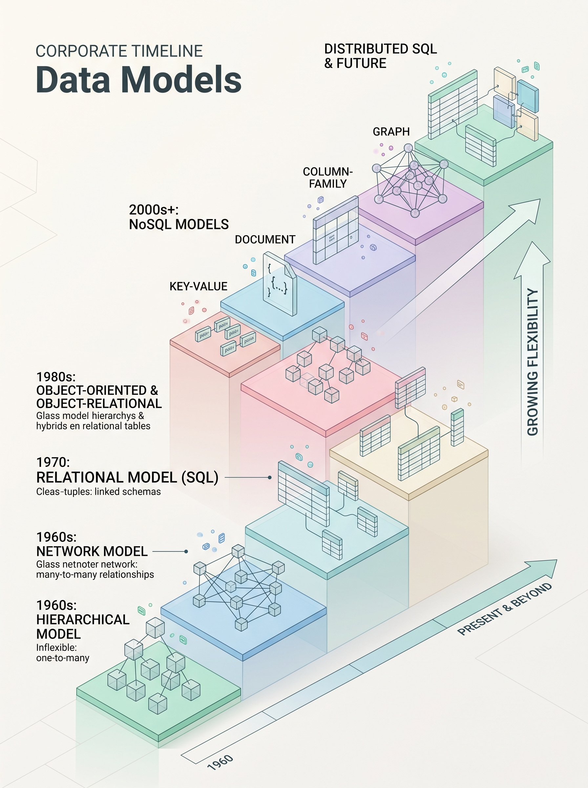

## Эволюция моделей данных

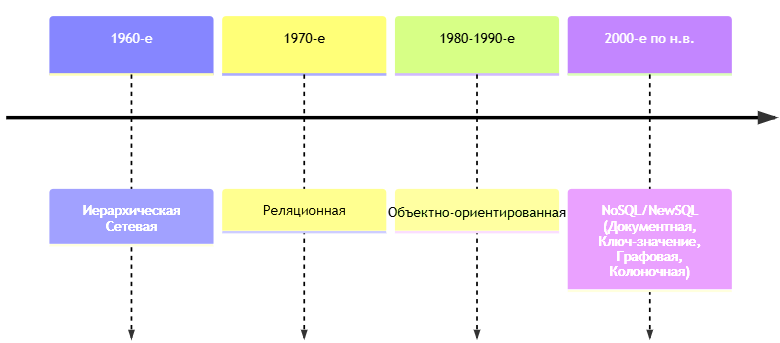

---


## 🎯 Ключевые критерии выбора

### 📐 **Эволюция от жесткости к гибкости:**
- **📋 Ранние модели (иерархическая, сетевая)** — жесткие структуры, сложные в изменении
- **🎨 Реляционная модель** — баланс структуры и гибкости через нормализацию
- **Cовременные NoSQL модели** — гибкость схемы, ориентированность на конкретные use cases

### ⚡ **По типу нагрузки:**
- **📖 OLTP** (транзакции) → Реляционная
- **📊 OLAP** (аналитика) → Колоночная
- **🚀 Высокочастотный доступ** → Ключ-значение

---


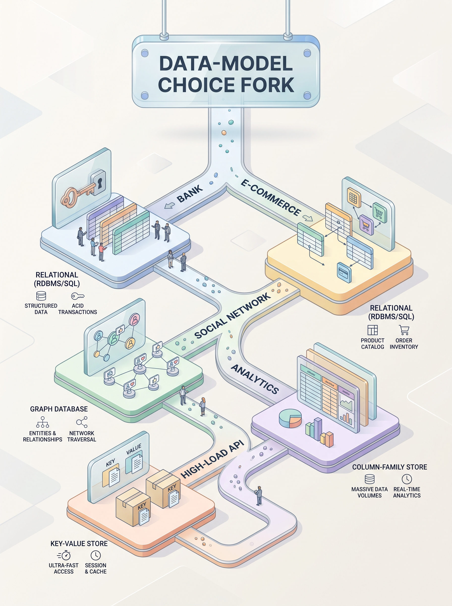

## 💡 Рекомендации по выбору

| Сценарий | 🥇 Модель | Почему |
|----------|-----------|--------|
| 🏦 Банковская система | 📊 Реляционная | ACID, сложные JOIN |
| 🛒 Интернет-магазин | 📄 Документная | гибкий JSON |
| 👥 Социальная сеть | 🕸️ Графовая | анализ связей |
| 📊 Бизнес-аналитика | 📊 Колоночная | агрегации, DWH |
| ⚡ Нагруженное API | 🔑 Ключ-значение | скорость |

---


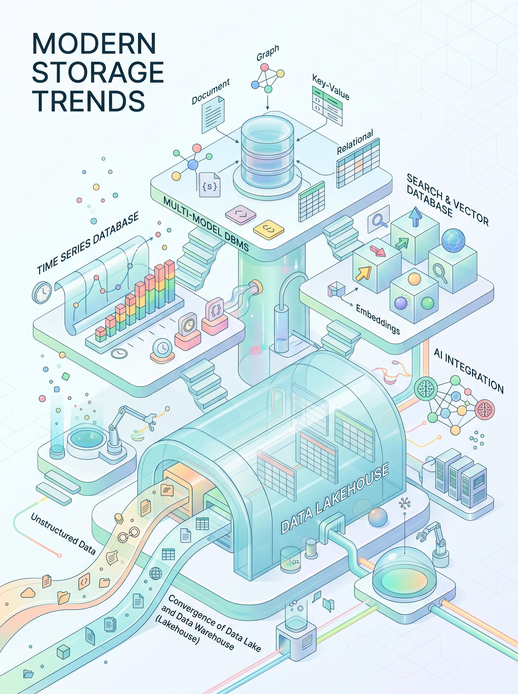

## 💡 Тренды хранения данных для Big Data

<div class="trend">

**1. Конвергенция моделей**
NewSQL — SQL-интерфейс + масштабируемость NoSQL · мультимодельные СУБД — несколько моделей в одной системе

</div>

<div class="trend">

**2. Специализированные решения**
временные ряды (Time Series DB) · поисковые движки (Elasticsearch) · vector databases для AI/ML

</div>

<div class="trend">

**3. Lakehouse-архитектура**
объединение data lakes и data warehouses · разные модели данных на единой платформе

</div>

---


## Тренды 2025–2026: лицензия тоже важна

**Redis 8 (2025):** добавлена AGPLv3 как вариант лицензирования.

При выборе хранилища проверяем версию и лицензию: открытый код, права использования и совместимость — разные вопросы.

<div class="source"><a href="https://redis.io/blog/agplv3/">Redis, 01.05.2025</a></div>
