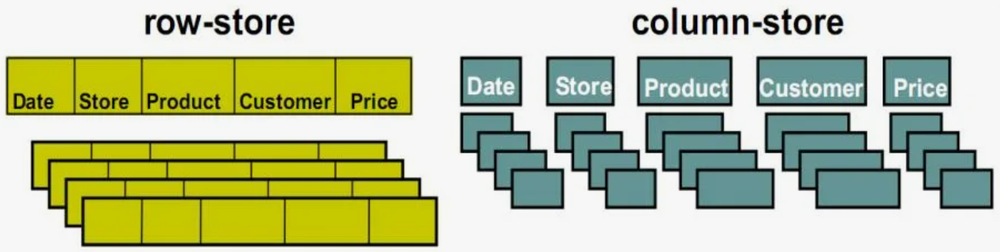

<style>

section.titleslide h1 {
    font-size: 60px;
    text-align: center;
    position: relative;
    color: Red;
    top: -40px;
}

section.titleslide h2 {
    font-size: 40px;
    color: DarkBlue;
    text-align: center;
    position: relative;
}

.red {
    color: Red;
}


h1 {
    font-size: 60px;
    position: absolute;
    top: 50px;
}
h2 {
    font-size: 40px;
    position: absolute;
    top: 70px;
    color: green; 
}
</style>

<!-- _class: titleslide -->
<!-- _paginate: false -->


# Технологии хранения данных (ч. 1).

## Лекция №2

---
## План лекции

1. Подходы хранения данных.
2. Модели данных.


---
<style scoped>
h2 {
    font-size: 40px;
    position: absolute;
    top: 50px;
    color: red; 
}
</style>  

## 1. Подходы хранения данных


---

<style scoped>

section.definition {
    background: rgba(255,255,255,0.1);
    padding: 20px;
    border-radius: 10px;
    margin: 20px 0;
    border-left: 4px solid #ff6b6b;
  }

section {
    font-size: 26px;
}

</style>  


## 📋 Что такое файловый подход?

- 🖥️ Каждое приложение работает со **своими собственными файлами**
- 📄 Данные хранятся в **плоских файлах** (flat files)
- 📏 Формат данных: **записи с полями фиксированной длины**

```text

Иванов Иван Иванович______Менеджер______________00001
Петров Петр Петрович______Разработчик___________00002

```

> *где _ — пробелы для заполнения*

---

<style scoped>

section {
    font-size: 24px;
    display: grid;
    align-items: center;
  }

h2 {
    font-size: 40px;
    position: absolute;
    top: 50px;
    left: 70px;
    color: green; 
  }

</style>


## 📚 Аналогия: Библиотека без системы

<div class = content>

- 📓 Каждая тетрадь = отдельный файл
- 🔍 Нет общего каталога
- 📝 Данные дублируются в разных тетрадях
- ⏱️ Чтобы найти информацию — нужно перебрать все тетради

</div>

---


## 🚨 Проблема 1: Совместная обработка данных

<style scoped>
section { font-size: 24px; padding-top: 110px; padding-right: 8%; }
h2 { top: 30px; left: 60px; font-size: 34px; }
ul { margin: 10px 0; }
li { margin: 10px 0; }
blockquote { background: rgba(46,125,91,0.10); border-left: 5px solid #2e7d5b; border-radius: 8px; padding: 8px 14px; font-size:24px; margin: 40px 0 }
</style>

- 🔗 Трудно организовать обработку данных из разных файлов
- 📊 Каждое приложение имеет свой формат данных
- 🌉 Для совместной обработки нужны программы-«мосты»
- 🚫 Нет стандартного интерфейса доступа к данным

> Пример: 📊 Бухгалтерия и 👥 отдел кадров работают с разными файлами сотрудников

---


## 🚨 Проблема 2: Дублирование данных

**Одни и те же данные хранятся в нескольких местах**

- 📫 Клиентские адреса в файле заказов и в файле рассылки
- 👨‍💼 Информация о сотрудниках в разных отделах
- 💸 Следствия: избыточность, риск несогласованности

---

## Проблема 3: Зависимость приложений от данных

**🔗 Логика приложения жестко привязана к структуре файла**

- 🔄 Любое изменение структуры файла требует переписывания ВСЕХ программ

```python
# Программа ожидает строго определенный формат
fio = file.read(30)    # ФИО всегда 30 символов
position = file.read(20) # Должность 20 символов
```

---

## 🚨 Проблема 4-5: Безопасность и целостность

**🔓 Нет контроля доступа**
- 🚪 Доступ по принципу «все или ничего»
- 👥 Невозможно настроить права для разных пользователей

**⚠️ Нет гарантий целостности**
- 📝 Можно записать любые данные (отрицательная зарплата)
- ✅ Нет проверок на корректность
- 🏢 Нет механизмов соблюдения бизнес-правил

---

## 🚨 Проблема 6: Восстановление после сбоев

- **⚡ Процесс обновления файла**
  1. 📖 Считать данные
  2. ✏️ Изменить в памяти
  3. 💾 Записать обратно
- 💥 **При сбое на шаге 3: данные теряются или повреждаются**
- ↩️ **Нет механизма отката к предыдущему согласованному состоянию**

---

## 🚨 Проблема 7: Совместный доступ

**⚔️ Конфликты при параллельной работе**

- 🔒 Файл блокируется целиком на время записи
- ⏳ Пока один пользователь редактирует, другие ждут
- 🚫 Нет изоляции транзакций
- 📉 Высокий риск потери данных

---

<style scoped>

section {
    font-size: 26px;
}

</style>


## 📊 Подход на основе баз данных

- **🗂️ Данные:** хранение в базе данных
- **🏗️ Формат/структура данных:** определяется логикой модели данных
- **🔗 Логическая связанность** данных вместо разрозненных файлов

---


## 📚 Определение базы данных

<style scoped>
section {
    font-size: 24px;
    padding-top: 110px;
    padding-right: 5%;
}
h2 { top: 30px; left: 60px; font-size: 36px; }
.def {
    background: rgba(46,125,91,0.10);
    border-left: 5px solid #2e7d5b;
    border-radius: 8px;
    padding: 10px 14px;
    margin: 10px 0;
}
.chip {
    display: inline-block;
    background: rgba(46,125,91,0.12);
    border-radius: 8px;
    padding: 6px 12px;
    font-size: 18px;
    margin: 6px 8px 0 0;
}
</style>

<div class="def">

**База данных** — коллекция логически связанных данных и их описаний, предназначенная для удовлетворения информационных потребностей предприятия.

</div>

<div class="def">

**База данных** — набор перманентных (постоянно хранимых) данных, используемых прикладными программными системами какого-либо предприятия.

</div>

**🎯 Ключевые аспекты:**

<span class="chip">✅ Постоянное хранение</span>
<span class="chip">✅ Корпоративное использование</span>
<span class="chip">✅ Интеграция с приложениями</span>

---

## 📊 Основные характеристики

**Данные: хранение в базе данных**
**Формат/структура данных: определяется логикой модели данных**

**🎯 Ключевые особенности:**
- ✅ Централизованное хранение данных
- ✅ Логическая структура вместо физических файлов
- ✅ Единая модель данных для всех приложений
- ✅ Профессиональное управление информацией

---

<style scoped>
section { font-size: 24px; padding-top: 110px; }
h2 { top: 30px; left: 60px; font-size: 34px; }
.def { background: rgba(46,125,91,0.10); border-left: 5px solid #2e7d5b; border-radius: 8px; padding: 10px 14px; margin: 10px 0; }
.chip { display: inline-block; background: rgba(46,125,91,0.12); border-radius: 8px; padding: 6px 12px; font-size: 24px; margin: 6px 8px 0 0; }
</style>

## 💾 Постоянное хранение данных

<div class="def">

**База данных — это некоторый набор перманентных (постоянно хранимых) данных, используемых прикладными программными системами какого-либо предприятия.**

</div>

**🎯 Важные аспекты:**

<span class="chip">💫 Перманентность</span>
<span class="chip">🖥️ Прикладные системы</span>
<span class="chip">🏢 Корпоративный масштаб</span>
<span class="chip">🔄 Непрерывная доступность</span>

---

<style scoped>
section { font-size: 24px; padding-top: 110px; }
h2 { top: 30px; left: 60px; font-size: 34px; }
.def { background: rgba(46,125,91,0.10); border-left: 5px solid #2e7d5b; border-radius: 8px; padding: 10px 14px; margin: 10px 0; }
.chip { display: inline-block; background: rgba(46,125,91,0.12); border-radius: 8px; padding: 6px 12px; font-size: 24px; margin: 6px 8px 0 0; }
</style>

## 📖 Метаданные - словарь данных

<div class="def">

**Описания данных – системный каталог, или словарь данных, или метаданные (данные о данных).**

</div>

**📋 Что включают метаданные:**

<span class="chip">🏷️ Структуры таблиц и полей</span>
<span class="chip">📏 Типы и ограничения</span>
<span class="chip">🔑 Ключи и индексы</span>
<span class="chip">👥 Права доступа</span>
<span class="chip">📊 Статистика использования</span>

---


## ⚙️ СУБД - управляющая система

<style scoped>
section { font-size: 24px; padding-top: 110px; padding-right: 8%; }
h2 { top: 30px; left: 60px; font-size: 34px; }
.def { background: rgba(46,125,91,0.10); border-left: 5px solid #2e7d5b; border-radius: 8px; padding: 10px 14px; margin: 10px 0; }
.chip { display: inline-block; background: rgba(46,125,91,0.12); border-radius: 8px; padding: 6px 12px; font-size: 18px; margin: 6px 8px 0 0; }
</style>

<div class="def">

**Система управления базами данных (СУБД)** – программная система, позволяющая пользователям определять, создавать, поддерживать данные и управлять доступом к базе данных. 

</div>

**🛠️ Основные функции СУБД:**

<span class="chip">📝 Определение структуры</span>
<span class="chip">🏗️ Создание и модификация</span>
<span class="chip">🔧 Поддержка и обслуживание</span>
<span class="chip">🛡️ Доступ и безопасность</span>

---

<style scoped>
section { font-size: 24px; padding-top: 110px; }
h2 { top: 30px; left: 60px; font-size: 34px; }
.def { background: rgba(46,125,91,0.10); border-left: 5px solid #2e7d5b; border-radius: 8px; padding: 10px 14px; margin: 10px 0; }
.chip { display: inline-block; background: rgba(46,125,91,0.12); border-radius: 8px; padding: 6px 12px; font-size: 19px; margin: 6px 8px 0 0; }
</style>

## 💻 Комплексная система хранения

<div class="def">

**Система баз данных** — это компьютеризированная система хранения записей, основное назначение которой — хранить информацию, предоставляя пользователям средства ее извлечения и модификации.

</div>

**🏗️ Компоненты системы:**

<span class="chip">💾 Аппаратное обеспечение</span>
<span class="chip">🗄️ База данных</span>
<span class="chip">⚙️ СУБД</span>
<span class="chip">👥 Пользователи и админы</span>
<span class="chip">📊 Прикладные программы</span>

---

<style scoped>
section { font-size: 24px; padding-top: 110px; }
h2 { top: 30px; left: 60px; font-size: 34px; }
.def { background: rgba(46,125,91,0.10); border-left: 5px solid #2e7d5b; border-radius: 8px; padding: 10px 14px; margin: 12px 0; }
</style>

## 🎯 Преимущества подхода БД

<div class="def">

**✅ Централизованное управление**
- Единая точка контроля
- Согласованность данных
- Оптимизация производительности

</div>

<div class="def">

**✅ Снижение избыточности**

- Исключение дублирования
- Эффективное использование ресурсов
- Снижение затрат на хранение

</div>

---

<style scoped>
section { font-size: 24px; padding-top: 110px; }
h2 { top: 30px; left: 60px; font-size: 34px; }
.def { background: rgba(46,125,91,0.10); border-left: 5px solid #2e7d5b; border-radius: 8px; padding: 10px 14px; margin: 12px 0; }
</style>

## 🛡️ Обеспечение целостности и безопасности

<div class="def">

**✅ Гарантии целостности данных**
- Ограничения и правила валидации
- Транзакции ACID
- Восстановление после сбоев

</div>

<div class="def">

**✅ Многоуровневая безопасность**

- Аутентификация пользователей
- Авторизация и права доступа
- Аудит операций с данными

</div>

---

<style scoped>
section { font-size: 24px; padding-top: 110px; }
h2 { top: 30px; left: 60px; font-size: 34px; }
.def { background: rgba(46,125,91,0.10); border-left: 5px solid #2e7d5b; border-radius: 8px; padding: 10px 14px; margin: 12px 0; }
</style>

## 🔄 Совместное использование данных

<div class="def">

**✅ Многопользовательский доступ**
- Параллельная работа без конфликтов
- Управление блокировками
- Изоляция транзакций

</div>

<div class="def">

**✅ Независимость от приложений**

- Изменение структуры без переписывания кода
- Единый интерфейс доступа
- Стандартизированные протоколы

</div>

---


## 🌟 Уровни архитектуры БД

<style scoped>

section {
    font-size: 24px;
    gap: 30px;
    align-items: center;
  }

h2 {
    font-size: 40px;
    position: absolute;
    top: 50px;
    left: 70px;
    color: green; 
  }

</style>

<div class = content>

**🏗️ Трехуровневая архитектура ANSI/SPARC:**
1. **Внешний уровень** - представления для пользователей
2. **Концептуальный уровень** - логическая структура данных  
3. **Внутренний уровень** - физическое хранение на дисках

**🎯 Принцип независимости:**
- Физическая независимость
- Логическая независимость

</div>

<div class = image>

</div>

---

<style scoped>
section { font-size: 24px; padding-top: 110px; }
h2 { top: 30px; left: 60px; font-size: 34px; }
.def { background: rgba(46,125,91,0.10); border-left: 5px solid #2e7d5b; border-radius: 8px; padding: 10px 14px; margin: 12px 0; }
</style>

## 💡 Ключевые выводы

<div class="def">

**🎯 Подход на основе БД обеспечивает:**
- Профессиональное управление корпоративными данными
- Гарантии целостности и безопасности информации
- Эффективное многопользовательское взаимодействие
- Масштабируемость для растущих потребностей

</div>

<div class="def">

**🚀 СУБД превращает данные в стратегический актив предприятия!**

</div>

---

<style scoped>

section {
    font-size: 26px;
}

</style>

## ⚖️ Сравнение подходов: Файлы vs Базы данных

| Критерий | 📁 Файловый подход | 🗄️ Базы данных |
|----------|-------------------|----------------|
| **Структура данных** | Разрозненные файлы | Единая логическая модель |
| **Связи между данными** | Отсутствуют | Логические связи через ключи |
| **Многопользовательский доступ** | Конфликты, блокировки файлов | Управление параллельным доступом |
| **Безопасность** | Права на уровне файлов | Гранулярные права доступа |
| **Метаданные** | В каждом приложении отдельно | Централизованный словарь данных |

---


<style scoped>

section {
    font-size: 25px;
}

</style>

## ⚖️ Сравнение подходов: Файлы vs Базы данных

| Критерий | 📁 Файловый подход | 🗄️ Базы данных |
|----------|-------------------|----------------|
| **Целостность данных** | Нет гарантий | Ограничения, транзакции ACID |
| **Восстановление после сбоев** | Сложно, риск потери | Журналирование, откат транзакций |
| **Производительность** | Линейный поиск | Индексы, оптимизация запросов |
| **Изменение структуры** | Переписывание приложений | Независимость данных |
| **Масштабируемость** | Ограничена | Горизонтальное и вертикальное |

---


## ⚠️ Недостатки баз данных

<style scoped>
section { font-size: 24px; padding-top: 110px; padding-right: 8%; }
h2 { top: 30px; left: 60px; font-size: 34px; }
.def { background: rgba(46,125,91,0.10); border-left: 5px solid #2e7d5b; border-radius: 8px; padding: 10px 14px; margin: 10px 0; }
</style>

<div class="def">

**🎯 Обзор проблемных аспектов:**
- 🏗️ Сложность реализации и сопровождения
- 💰 Высокие финансовые затраты
- ⚡ Производительность и надежность
- 👥 Требования к квалификации персонала

</div>

<div class="def">

**Базы данных — это не панацея, а сложный инструмент со своими ограничениями**

</div>

---

## 🏗️ Сложность организации

**Сложность (нужны специалисты)**

**👥 Многоуровневая структура пользователей:**
- 👨‍💻 Прикладные программисты
- 👩‍💼 Конечные пользователи
- 🛠️ Администраторы баз данных (АБД / DBA)
- 🏗️ Администраторы/архитекторы данных (АД / DA)
- 📐 Проектировщики базы данных

**Каждая роль требует специальных знаний и навыков**

---
<style scoped>

section {
    font-size: 24px;
}

</style>


## 👥 Ключевые роли в управлении БД

<style scoped>
section { font-size: 24px; padding-top: 110px; padding-right: 8%; }
h2 { top: 30px; left: 60px; font-size: 34px; }
.def { background: rgba(46,125,91,0.10); border-left: 5px solid #2e7d5b; border-radius: 8px; padding: 10px 14px; margin: 12px 0; }
</style>

<div class="def">

**🛠️ Администратор базы данных (DBA):**
- Установка и настройка СУБД
- Резервное копирование и восстановление
- Мониторинг производительности
- Управление безопасностью

</div>

<div class="def">

**🏗️ Администратор/архитектор данных (DA):**

- Проектирование логической структуры
- Разработка стандартов данных
- Планирование развития системы
- Управление метаданными

</div>

---


## 💾 Аппаратные требования

**Большой масштаб (следствие – требуется мощное аппаратное обеспечение, много памяти, быстрые процессоры)**

**⚡ Высокие требования к инфраструктуре:**
- 🖥️ Мощные серверы с многоядерными процессорами
- 💽 Быстрые системы хранения (SSD, RAID)
- 📊 Большой объем оперативной памяти
- 🔄 Высокоскоростная сетевая инфраструктура
- ⚡ Системы бесперебойного питания

---

## 💰 Финансовые затраты

**Высокая стоимость коммерческих СУБД, но есть альтернатива – свободное ПО, например, PostgreSQL, но с позиции стоимости это не точно… :-)**

**📊 Структура затрат:**
- 💸 Лицензии на коммерческие СУБД (Oracle, SQL Server)
- 🖥️ Дорогое аппаратное обеспечение
- 👥 Зарплаты квалифицированных специалистов
- 📚 Обучение и сертификация персонала
- 🔧 Техническая поддержка и обновления

---

## 🔄 Стоимость миграции

**Высокая стоимость перехода от устаревших систем, основанных на файлах, к современным СУБД**

**🔄 Затраты на миграцию включают:**
- 📊 Анализ и проектирование новой структуры
- 🔄 Конвертацию данных из старых форматов
- 🧪 Тестирование и отладку системы
- 👥 Обучение пользователей новым интерфейсам
- ⏱️ Простой бизнес-процессов во время перехода

---

## ⚡ Производительность

**Более низкая скорость работы, чем у специализированных приложений, написанных с учетом специфики решаемой задачи**

**📉 Факторы снижения производительности:**
- 🎯 Универсальность vs специализация
- 🔄 Накладные расходы СУБД
- 📊 Оптимизация для общего случая
- ⚡ Задержки на управление транзакциями
- 🔒 Блокировки и управление параллельным доступом

---


## 🚨 Риски отказов

<style scoped>
section { font-size: 24px; padding-top: 110px; padding-right: 8%; }
h2 { top: 30px; left: 60px; font-size: 34px; }
.def { background: rgba(46,125,91,0.10); border-left: 5px solid #2e7d5b; border-radius: 8px; padding: 10px 14px; margin: 10px 0; }
.chip { display: inline-block; background: rgba(46,125,91,0.12); border-radius: 8px; padding: 6px 12px; font-size: 18px; margin: 6px 8px 0 0; }
</style>

<div class="def">

**Большой масштаб проблем при сбоях сервера баз данных**

</div>

**💥 Масштаб последствий сбоя:**

<span class="chip">🚫 Все приложения недоступны</span>
<span class="chip">💼 Остановка процессов</span>
<span class="chip">📉 Потеря транзакций</span>
<span class="chip">🔄 Долгое восстановление</span>
<span class="chip">🏢 Репутационные потери</span>

---


## 🛡️ Меры снижения рисков

<style scoped>
section { font-size: 24px; padding-top: 110px; padding-right: 8%; }
h2 { top: 30px; left: 60px; font-size: 34px; }
.def { background: rgba(46,125,91,0.10); border-left: 5px solid #2e7d5b; border-radius: 8px; padding: 10px 14px; margin: 10px 0; }
</style>

<div class="def">

**✅ Стратегии минимизации недостатков:**
- 🔄 Регулярное резервное копирование
- ⚡ Кластеризация и репликация
- 📊 Мониторинг производительности
- 👥 Обучение и сертификация персонала
- 🧪 Тщательное тестирование изменений

</div>

<div class="def">

**Правильная архитектура и грамотное администрирование позволяют минимизировать риски**

</div>

---

<style scoped>

section {
    font-size: 24px;
}

</style>

## ⚖️ Баланс преимуществ и недостатков

**✅ Преимущества БД:**
- Централизованное управление данными
- Гарантии целостности и безопасности
- Эффективное многопользовательское использование
- Стандартизированные интерфейсы доступа

**❌ Недостатки БД:**
- Высокая сложность и стоимость
- Требования к квалификации персонала
- Риски централизованного отказа
- Накладные расходы на производительность

---

<style scoped>
section { font-size: 24px; padding-top: 80px; }
h2 { top: 30px; left: 60px; font-size: 34px; }
.def { background: rgba(46,125,91,0.10); border-left: 5px solid #2e7d5b; border-radius: 8px; padding: 10px 14px; margin: 12px 0; }
</style>

## 💡 Выводы

<div class="def">

**🎯 Критически важные аспекты:**
- Базы данных требуют серьезных инвестиций
- Необходима команда квалифицированных специалистов
- Важна продуманная архитектура и инфраструктура
- Требуются планы аварийного восстановления

</div>

<div class="def">

**Решение о внедрении БД должно быть экономически обоснованным и учитывать все затраты**

</div>

---

<style scoped>
h2 {
    font-size: 40px;
    position: absolute;
    top: 50px;
    color: red; 
}
</style>  

## 2. Модели данных


---

## Что такое модель данных?

*   **Формальная система** для описания, представления и работы с данными.
*   **Определяет:**
    *   Структуру данных (как данные организованы).
    *   Ограничения (какие данные допустимы).
    *   Операции (как данные можно изменять и запрашивать).
*   **Выбор модели определяет** эффективность решения задач.

---


## 1. Иерархическая модель

<style scoped>

section {
    font-size: 24px;
    gap: 30px;
    align-items: center;
  }

h2 {
    font-size: 40px;
    position: absolute;
    top: 50px;
    left: 70px;
    color: green; 
  }

</style>

<div class = content>

**Суть:** Данные организованы в виде дерева (древовидная структура) с отношениями «предок-потомок».
- **Структура**: Узел может иметь только одного родителя.
- **Операции**: Навигация от корня вниз.
- **Плюсы**: Высокая скорость доступа к данным, следующих по иерархии.
- **Минусы**: Сложность изменения структуры, избыточность данных, неестественность для сложных связей.

> Пример: Файловые системы, реестр Windows, IBM IMS.

</div>


---

## 2. Сетевая модель

<style scoped>

section {
    font-size: 24px;
    display: grid;
    grid-template-columns: 60% 40%;
    gap: 30px;
    align-items: center;
  }

section.content {
    grid-column: 1;
  }

section.image {
    grid-column: 2;
    text-align: center;
  }

h2 {
    font-size: 40px;
    position: absolute;
    top: 50px;
    left: 70px;
    color: green; 
  }

</style>

<div class = content>

**Суть:** Развитие иерархической модели. Узел может иметь несколько родителей, образуя сеть.
- **Структура**: Сложные связи "многие-ко-многим" реализуются напрямую.
- **Операции**: Более гибкая навигация, но сложная.
- **Плюсы**: Более гибкая, чем иерархическая, меньше избыточности.
- **Минусы**: Высокая сложность проектирования и приложений, неестественность для сложных связей.

> Пример: CODASYL, IDMS.

</div>

<div class = image>


</div>

---


## 3. Реляционная модель

<style scoped>

section {
    font-size: 20px;
    gap: 30px;
    align-items: center;
  }

h2 {
    font-size: 40px;
    position: absolute;
    top: 50px;
    left: 70px;
    color: green; 
  }

</style>

<div class = content>

**Суть:** Данные представлены в виде набора взаимосвязанных таблиц (отношений).
- **Структура**: 
  - Таблица (Отношение): Студенты (id, Имя, Группа)
  - Строка (Кортеж): (101, 'Иван Иванов', 'БД-01')
  - Столбец (Атрибут): Имя
  - Связи: через ключи (первичные и внешние)
- **Операции**: SQL (Structured Query Language) — декларативный язык запросов.
- **Плюсы**: ростота понимания, мощный математический фундамент, независимость данных, ACID-транзакции.
- **Минусы**: Сложность горизонтального масштабирования для очень больших объемов.

> Пример: PostgreSQL, MySQL, Oracle Database.

</div>

<div class = image>

</div>

---

## 4. Объектно-ориентированная модель

<style scoped>

section {
    font-size: 20px;
    display: grid;
    grid-template-columns: 60% 40%;
    gap: 30px;
    align-items: center;
  }

section.content {
    grid-column: 1;
  }

section.image {
    grid-column: 2;
    text-align: center;
  }

h2 {
    font-size: 40px;
    position: absolute;
    top: 50px;
    left: 70px;
    color: green; 
  }

</style>

<div class = content>

**Суть:** Данные хранятся в виде объектов, как в объектно-ориентированном программировании (ООП).
- **Структура**: Объекты с атрибутами, методами и наследованием. 
- **Операции**: Работа через методы объектов.
- **Плюсы**: Прямое отображение объектов программы на БД, нет "импеданса" (несоответствия).
- **Минусы**: Сложность, низкая популярность, вытеснена более простыми решениями.

> Пример: Objectivity/DB, Versant. *Идея живет в ORM (Hibernate) для реляционных БД.*

</div>

<div class = image>


</div>

---


## 5. Документная (Документ-ориентированная) модель

<style scoped>

section {
    font-size: 20px;

    gap: 30px;
    align-items: center;
  }

section.content {
    grid-column: 1;
  }

section.image {
    grid-column: 2;
    text-align: center;
  }

h2 {
    font-size: 40px;
    position: absolute;
    top: 50px;
    left: 70px;
    color: green; 
  }

</style>

<div class = content>

**Суть:** Подвид NoSQL. Данные хранятся в виде документов (например, JSON/BSON).
- **Структура**: Коллекции документов. Документы самодостаточны и могут иметь разную структуру. 
- **Операции**: Запросы по полям документа. CRUD-операции.
- **Плюсы**: Гибкая схема, естественность для разработки (JSON), высокая производительность для определенных сценариев.
- **Минусы**: Отсутствие JOIN (связи между коллекциями сложны), дублирование данных.

> **Примеры**: MongoDB, Couchbase.

</div>

---

## 6. Хранилища «ключ-значение» (Key-Value)

<style scoped>

section {
    font-size: 20px;
    display: grid;
    grid-template-columns: 60% 40%;
    gap: 30px;
    align-items: center;
  }

section.content {
    grid-column: 1;
  }

section.image {
    grid-column: 2;
    text-align: center;
  }

h2 {
    font-size: 40px;
    position: absolute;
    top: 50px;
    left: 70px;
    color: green; 
  }

</style>

<div class = content>

**Суть:** Простейшая модель NoSQL. Данные — ассоциативный массив (словарь).
- **Структура**: Уникальный ключ → значение (часто неструктурированное для СУБД). 
- **Операции**: PUT(key, value), GET(key), DELETE(key).
- **Плюсы**: Максимальная скорость и масштабируемость для простых операций.
- **Минусы**: Нет сложных запросов (только по ключу).

> **Примеры**: Redis, Amazon DynamoDB, etcd.

</div>

<div class = image>


</div>

---


## 7. Графовая модель

<style scoped>

section {
    font-size: 20px;
    gap: 30px;
    align-items: center;
  }

section.content {
    grid-column: 1;
  }

section.image {
    grid-column: 2;
    text-align: center;
  }

h2 {
    font-size: 40px;
    position: absolute;
    top: 50px;
    left: 70px;
    color: green; 
  }

</style>

<div class = content>

**Суть:** Данные представлены в виде узлов, свойств и ребер (связей).
- **Структура**: 
  - Узлы (Node/Vertex): Сущности (например, Студент, Группа).
  - Ребра (Edge/Relationship): Связи между узлами (ДРУЖИТ_С, УЧИТСЯ_В). Могут иметь свои свойства.
- **Операции**: Запросы на обход графа (найти друзей друзей).
- **Плюсы**: Невероятно эффективна для анализа связей.
- **Минусы**: Неэффективна для агрегаций и задач, не связанных с обходом связей.

> **Примеры**: Neo4j, Amazon Neptune.

</div>

<div class = image>

</div>

---

## 8. Колоночная модель (Семейства столбцов)

<style scoped>

section {
    font-size: 20px;
    display: grid;
    grid-template-columns: 60% 40%;
    gap: 30px;
    align-items: center;
  }

section.content {
    grid-column: 1;
  }

section.image {
    grid-column: 2;
    text-align: center;
  }

h2 {
    font-size: 40px;
    position: absolute;
    top: 50px;
    left: 70px;
    color: green; 
  }

</style>

<div class = content>

**Суть:** Данные хранятся и обрабатываются по столбцам, а не по строкам.
- **Структура**: Узлы (Node/Vertex): Сущности (например, Студент, Группа).
- **Операции**: Агрегации (SUM, AVG, COUNT) по конкретным столбцам выполняются очень быстро.
- **Плюсы**: Высокая скорость аналитических запросов, отличное сжатие.
- **Минусы**: Низкая скорость операций записи/обновления отдельных строк.

> **Примеры**: Google Bigtable, Apache Cassandra, HBase (NoSQL), ClickHouse, Amazon Redshift (Analytical DB).

</div>

<div class = image>




</div>

---
<style scoped>

section {
    font-size: 21px;
}

</style>

## 📊 Сравнительный анализ моделей данных

| Модель | 🎯 Основная сила | ⚠️ Слабые стороны | 💡 Идеальное применение |
|--------|------------------|-------------------|-------------------------|
| **🌳 Иерархическая** | 🚀 Скорость доступа по иерархии | 🏗️ Сложность изменения структуры | 📁 Файловые системы, конфигурации |
| **🔗 Сетевая** | 🔄 Гибкость связей (много родителей) | 🧩 Высокая сложность проектирования | 🏢 Сложные бизнес-процессы |
| **📊 Реляционная** | 💪 Целостность, сложные JOIN-запросы | 📈 Сложность горизонтального масштабирования | 🏦 Транзакционные системы, банки |
| **🧩 Объектно-ориентированная** | 🔄 Прямое отображение объектов кода | 📉 Низкая популярность, сложность | 💻 Сложные объектные системы |

---
<style scoped>

section {
    font-size: 21px;
}

</style>

## 📊 Сравнительный анализ моделей данных

| Модель | 🎯 Основная сила | ⚠️ Слабые стороны | 💡 Идеальное применение |
|--------|------------------|-------------------|-------------------------|
| **📄 Документная** | 🎨 Гибкая схема, быстрая разработка | 🔗 Нет JOIN между коллекциями | 🛍️ Каталоги, контент-платформы |
| **🔑 Ключ-значение** | 🚀 Максимальная скорость простых операций | 🔍 Нет сложных запросов | ⚡ Кэши, сессии, метрики |
| **🕸️ Графовая** | 🔗 Анализ связей любой сложности | 📊 Неэффективна для агрегаций | 👥 Соцсети, рекомендации |
| **📊 Колоночная** | 📈 Скорость аналитики и агрегаций | 🔄 Медленные операции записи | 📈 Data Warehousing, аналитика |

---


## Эволюция моделей данных


---

<style scoped>

section {
    font-size: 24px;
}

</style>

## 🎯 Ключевые критерии выбора

### 📐 **Эволюция от жесткости к гибкости:**
- **📋 Ранние модели (иерархическая, сетевая)** — жесткие структуры, сложные в изменении
- **🎨 Реляционная модель** — баланс структуры и гибкости через нормализацию
- **Cовременные NoSQL модели** — гибкость схемы, ориентированность на конкретные use cases

### ⚡ **По типу нагрузки:**
- **📖 OLTP** (транзакции) → Реляционная
- **📊 OLAP** (аналитика) → Колоночная
- **🚀 Высокочастотный доступ** → Ключ-значение

---

<style scoped>

section {
    font-size: 24px;
    padding-top: 110px;
    padding-right: 8%;
}
h2 { top: 30px; left: 60px; font-size: 34px; }
table { font-size: 24px; }
th { background: rgba(46,125,91,0.15); }
td { padding: 8px 10px; }

</style>


## 💡 Рекомендации по выбору

| Сценарий | 🥇 Модель | Почему |
|----------|-----------|--------|
| 🏦 Банковская система | 📊 Реляционная | ACID, сложные JOIN |
| 🛒 Интернет-магазин | 📄 Документная | гибкий JSON |
| 👥 Социальная сеть | 🕸️ Графовая | анализ связей |
| 📊 Бизнес-аналитика | 📊 Колоночная | агрегации, DWH |
| ⚡ Нагруженное API | 🔑 Ключ-значение | скорость |

---


<style scoped>

section {
    font-size: 24px;
    padding-top: 110px;
    padding-right: 5%;
}
h2 { top: 30px; left: 60px; font-size: 33px; }
.trend { background: rgba(46,125,91,0.10); border-left: 5px solid #2e7d5b; border-radius: 8px; padding: 8px 14px; margin: 10px 0; }

</style>


## 💡 Тренды хранения данных для Big Data

<div class="trend">

**1. Конвергенция моделей**
NewSQL — SQL-интерфейс + масштабируемость NoSQL · мультимодельные СУБД — несколько моделей в одной системе

</div>

<div class="trend">

**2. Специализированные решения**
временные ряды (Time Series DB) · поисковые движки (Elasticsearch) · vector databases для AI/ML

</div>

<div class="trend">

**3. Lakehouse-архитектура**
объединение data lakes и data warehouses · разные модели данных на единой платформе

</div>
